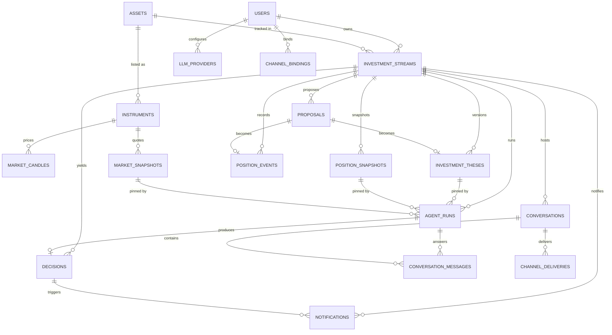

# 01 · 领域模型与数据边界

> 状态：草案 v0.1（含对话域）
> 对应决策：`00-decisions.md` D1–D14
> 说明：本文是设计口径，不是最终 Migration；字段名可在实现时微调，但聚合边界与不变量不应随意改变。

---

## 1. 设计目标

1. **三分明确**：客观市场事实、用户真实持仓、用户正式观点、AI 推断，四类信息各有归属，不互相覆盖。
2. **可追溯**：任何一次分析或对话，都能回答「用了哪一版 Thesis、哪份持仓、哪个时间点的行情、哪个模型」。
3. **对话与监控同源**：对话和定时分析共享同一份上下文与工具，不出现两个 Agent 各说各话。
4. **不过度设计**：v1 只支持 BTC 现货与单用户；不因为未来可能的多租户、多资产、合约而把当前模型复杂化，但保留扩展位。

---

## 2. 限界上下文

| 上下文 | 职责 | 核心对象 | 不负责 |
|---|---|---|---|
| Identity & Config | 本地用户、LLM Provider、通知偏好、渠道绑定 | `users`, `llm_providers`, `channel_bindings` | 登录、多租户、权限系统 |
| Market Data | Instrument、K 线、行情快照、指标计算 | `assets`, `instruments`, `market_candles`, `market_snapshots` | 交易、下单 |
| Portfolio | 真实持仓、成交事件、持仓快照、风险计算 | `positions`, `position_events`, `position_snapshots` | AI 建议仓位、自动调仓 |
| Thesis | 投资目标与观点的版本化、确认、生效 | `investment_theses`, `proposals` | 聊天记录、AI 记忆 |
| Agent Runtime | 上下文装配、工具调用、模型调用、运行审计 | `agent_runs`, `decisions`, `agent_memories` | 直接写持仓/观点 |
| Conversation & Channel | 多轮对话、消息、IM 适配、投递 | `conversations`, `conversation_messages`, `channel_deliveries` | 业务规则、持仓计算 |
| Notification | 通知策略、去重、冷却、发送 | `notifications`, `notification_deliveries` | 由 LLM 决定是否发送 |
| Ops | 定时任务、异步任务、审计日志 | `jobs`, `audit_logs` | 业务语义 |

依赖方向：`Conversation & Channel → Agent Runtime → Market/Portfolio/Thesis`；渠道适配器只依赖 Conversation 应用服务，不直接依赖领域仓储。

---

## 3. 聚合与不变量

### 3.1 Investment Stream

一个 Stream = 一个用户在一个资产上的独立投资上下文（Thesis、持仓、分析历史、通知配置）。

- 首版每个用户只有一个 ACTIVE Stream；数据库**不建** `UNIQUE(user_id, asset_id)`，为同一资产多个 Stream（长期配置 / 短线波段）预留。
- Stream 通过 `primary_instrument_id` 指定行情标的；Asset 与 Instrument 分离，未来同一 BTC 可换 Binance/OKX/Coinbase。
- `monitor_interval_minutes` 为调度频率；`agent_enabled` 为总开关；暂停不改历史。

### 3.2 Investment Thesis

- **只追加，不覆盖**：每次更新生成新 `version`。
- 同一 Stream 任一时刻最多一个 `ACTIVE` 版本（部分唯一索引保证）。
- `original_text` 必存，且是用户原话；`structured_content` 是整理结果，不能反过来覆盖原文。
- `source` 区分 `USER` / `AGENT` / `SYSTEM`；Agent 生成的内容在确认前只能是 `PENDING_CONFIRMATION`。
- `change_class` 为 `MATERIAL` 时必须有 `confirmed_at` 才能 `ACTIVE`；`MINOR` 可由用户提交后直接生效。
- 新版本生效时，旧 `ACTIVE` 原子地变为 `SUPERSEDED` 并写入 `effective_until`。
- 只有 `ACTIVE` 版本进入 Agent 上下文；历史版本可查询、可对比，不删除。
- AI 可以指出与旧版本冲突，但不能自行修改；冲突以编辑器提示或建议文本呈现，v1.2+ 才用 Proposal。

### 3.3 Position

- `positions` 是**当前读模型**，不是事实来源；事实来源是 `position_events`。
- 每个持仓变更必须在同一事务内：写 event → 重算 positions → 写 immutable snapshot。
- `position_events` 只追加；修正（CORRECTION）记录 `before_state` / `after_state`，不静默覆盖。
- `position_snapshots` 不可变，供 Agent Run 固定引用；快照只保存持仓状态（数量、成本、已实现盈亏），**不把当时市价烘进快照**，市值/浮盈在分析时用对应行情快照计算，避免旧价格伪装成新估值。
- v1 只支持现货；合约不塞进同一张表，未来用独立 `derivative_positions` 子域。

### 3.4 Agent Run 与 Decision

- 每次分析/对话/解析创建一条 `agent_runs`，完成后不可变。
- Run 必须固定：`thesis_version_id`、`position_snapshot_id`、`market_snapshot_id`、`prompt_version`、`model`、`input_digest`。
- 定时分析 Run 与 Decision 一对一（`decisions.agent_run_id` 唯一）；对话 Run 可以没有 Decision。
- `decisions` 只追加；修正结论要产生新的 Run/Decision，不 UPDATE 旧记录。
- `agent_memories` 只存 Agent 自己提炼的观察，带来源 Run 与置信度，**不等于用户观点**。

### 3.5 Conversation 与 Proposal

- `Conversation` 归属于一个 Stream，渠道 + 外部线程唯一。
- `ConversationMessage` 只追加；`seq` 在同一 conversation 内单调递增（事务内对 conversation 行加锁分配）。
- 用户消息可以幂等：`(channel, external_message_id)` 唯一，重复 webhook 不重复回复。
- v1.0 对话只读：没有写工具，也不创建 Proposal；正式变更由用户在编辑器/表单显式提交。
- `Proposal` 是 v1.2+ 的「待确认变更意图」，有 TTL、基准版本、来源 Run/Message；确认后由领域服务落库。
- 确认时若 `base_thesis_version_id` 已不是当前 ACTIVE 版本，标记 `STALE`，要求重新生成，不做自动合并。

### 3.6 Channel Binding

- `(channel, external_user_id)` 唯一；状态 `ACTIVE` / `REVOKED`。
- 未绑定或已撤销的发送者不得触发任何 Agent 调用。
- 配对码只存 hash，一次性使用，10 分钟过期。
- v1.0/v1.1 渠道只读，没有确认动作；未来若开放渠道写操作，令牌与 Proposal 绑定，单次使用，TTL 15 分钟。

### 3.7 不变量清单

| # | 不变量 | 保证方式 |
|---|---|---|
| I1 | 每个 Stream 最多一个 ACTIVE Thesis | 部分唯一索引 + 事务 |
| I2 | Thesis 版本只增不改 | 应用层禁止 UPDATE 内容；DB 权限可后续收紧 |
| I3 | 只有 ACTIVE Thesis 进入上下文 | ContextBuilder 只查 ACTIVE |
| I4 | 持仓事件只追加 | 应用层；CORRECTION 记录前后值 |
| I5 | 持仓变更 = event + snapshot + 读模型，同一事务 | 领域服务 |
| I6 | Agent Run 固定的输入引用不可变 | 完成后禁止更新 |
| I7 | 一个 Monitor Run 最多一个 Decision | `UNIQUE(agent_run_id)` |
| I8 | 对话消息只追加、seq 单调 | 行锁 + `UNIQUE(conversation_id, seq)` |
| I9 | 渠道入站幂等 | `UNIQUE(channel, external_message_id)` |
| I10 | 正式事实只能由用户显式提交/确认改写 | v1.0 对话无写工具；编辑器/表单 + audit |
| I11 | 金额/价格用 NUMERIC + Decimal | 类型约束 + 代码规范 |
| I12 | 过期行情不得伪装实时 | `staleness` 字段 + Prompt 规则 |
| I13 | 密钥不进入日志/上下文 | 加密存储 + 日志脱敏 |

---

## 4. ER 图



---

## 5. 核心表草案

> 约定：ID 用 UUID；时间用 `TIMESTAMPTZ`；金额/价格/数量用 `NUMERIC(38,18)`；百分比用 `NUMERIC(10,4)`；JSON 中的小数以字符串保存（避免 JS 浮点），应用层转 `Decimal`。

### 5.1 用户与配置

```sql
-- 单租户：首个 Migration seed 一行；保留 user_id 为未来多租户留位
users (
    id              uuid primary key,
    email           text unique,
    display_name    text,
    timezone        text not null default 'Asia/Shanghai',
    created_at      timestamptz not null default now()
);

llm_providers (
    id                  uuid primary key,
    user_id             uuid not null references users(id),
    name                text not null,
    base_url            text not null,
    api_key_ciphertext  bytea not null,
    api_key_hint        text,              -- 仅末 4 位，用于展示
    model               text not null,
    extra               jsonb not null default '{}',
    status              text not null default 'UNTESTED', -- UNTESTED/OK/FAILED
    last_tested_at      timestamptz,
    created_at          timestamptz not null default now(),
    updated_at          timestamptz not null default now()
);
```

### 5.2 资产与行情

```sql
assets (
    id          uuid primary key,
    symbol      text not null unique,      -- BTC
    name        text not null,
    kind        text not null,             -- CRYPTO / EQUITY / ETF
    created_at  timestamptz not null default now()
);

instruments (
    id              uuid primary key,
    asset_id        uuid not null references assets(id),
    provider        text not null,         -- binance
    symbol          text not null,         -- BTCUSDT
    market_type     text not null,         -- SPOT（PERP 预留）
    quote_currency  text not null,         -- USDT
    status          text not null default 'ACTIVE',
    meta            jsonb not null default '{}',
    unique (provider, symbol, market_type)
);

market_candles (
    instrument_id  uuid not null references instruments(id),
    timeframe      text not null,          -- 1h / 4h / 1d
    open_time      timestamptz not null,
    open           numeric(38,18) not null,
    high           numeric(38,18) not null,
    low            numeric(38,18) not null,
    close          numeric(38,18) not null,
    volume         numeric(38,18) not null,
    source         text not null,
    primary key (instrument_id, timeframe, open_time)
);

market_snapshots (
    id              uuid primary key,
    instrument_id   uuid not null references instruments(id),
    source          text not null,
    price           numeric(38,18) not null,
    change_24h_pct  numeric(10,4),
    volume_24h      numeric(38,18),
    high_24h        numeric(38,18),
    low_24h         numeric(38,18),
    market_time     timestamptz not null,  -- 交易所行情时间
    fetched_at      timestamptz not null,  -- 我方采集时间
    staleness       text not null,         -- FRESH / STALE / UNKNOWN
    indicators      jsonb not null default '{}',
    candle_coverage jsonb not null default '{}',
    raw             jsonb,
    created_at      timestamptz not null default now()
);
```

### 5.3 Stream 与 Thesis

```sql
investment_streams (
    id                      uuid primary key,
    user_id                 uuid not null references users(id),
    asset_id                uuid not null references assets(id),
    primary_instrument_id   uuid not null references instruments(id),
    name                    text not null,
    status                  text not null default 'ACTIVE', -- ACTIVE/PAUSED/ARCHIVED
    timezone                text not null default 'Asia/Shanghai',
    monitor_interval_minutes integer not null default 60,
    agent_enabled           boolean not null default true,
    config                  jsonb not null default '{}',
    created_at              timestamptz not null default now(),
    updated_at              timestamptz not null default now()
);
-- 刻意不建 UNIQUE(user_id, asset_id)

investment_theses (
    id                  uuid primary key,
    stream_id           uuid not null references investment_streams(id),
    version             integer not null,
    status              text not null,      -- DRAFT/PENDING_CONFIRMATION/ACTIVE/SUPERSEDED/REJECTED/ARCHIVED
    source              text not null,      -- USER/AGENT/SYSTEM
    change_class        text not null,      -- MINOR/MATERIAL
    original_text       text not null,
    structured_content  jsonb not null default '{}',
    diff_from_previous  jsonb,
    source_agent_run_id uuid,               -- AI 整理时记录；不设外键以免循环依赖
    confirmed_at        timestamptz,
    effective_from      timestamptz not null default now(),
    effective_until     timestamptz,
    created_at          timestamptz not null default now(),
    unique (stream_id, version)
);

create unique index uq_thesis_one_active
    on investment_theses (stream_id)
    where status = 'ACTIVE';

create unique index uq_thesis_one_pending
    on investment_theses (stream_id)
    where status = 'PENDING_CONFIRMATION';
```

### 5.4 持仓

```sql
positions (
    id              uuid primary key,
    stream_id       uuid not null unique references investment_streams(id),
    instrument_id   uuid not null references instruments(id),
    quantity        numeric(38,18) not null default 0,
    avg_cost        numeric(38,18) not null default 0,
    cost_currency   text not null default 'USDT',
    realized_pnl    numeric(38,18) not null default 0,
    fee_paid        numeric(38,18) not null default 0,
    version         integer not null default 1,
    updated_at      timestamptz not null default now()
);

position_events (
    id                  uuid primary key,
    stream_id           uuid not null references investment_streams(id),
    kind                text not null,      -- BUY/SELL/CORRECTION/OPENING
    side                text,               -- BUY/SELL
    quantity            numeric(38,18),
    price               numeric(38,18),
    fee                 numeric(38,18) not null default 0,
    occurred_at         timestamptz not null,
    note                text,
    source              text not null default 'MANUAL',
    before_state        jsonb,              -- 修正前
    after_state         jsonb,              -- 修正后
    resulting_snapshot_id uuid,
    created_at          timestamptz not null default now()
);

position_snapshots (
    id                  uuid primary key,
    stream_id           uuid not null references investment_streams(id),
    position_version    integer not null,
    as_of               timestamptz not null,
    quantity            numeric(38,18) not null,
    avg_cost            numeric(38,18) not null,
    cost_currency       text not null,
    realized_pnl        numeric(38,18) not null default 0,
    source_event_id     uuid references position_events(id),
    created_at          timestamptz not null default now()
);
```

### 5.5 Agent Run 与 Decision

```sql
agent_runs (
    id                  uuid primary key,
    stream_id           uuid not null references investment_streams(id),
    task_type           text not null,      -- MONITOR_ANALYSIS/CONVERSATION_REPLY/THESIS_PARSE
    status              text not null,      -- RUNNING/SUCCEEDED/FAILED/CANCELLED
    llm_provider_id     uuid references llm_providers(id),
    model               text,
    prompt_version      text not null,
    thesis_version_id   uuid references investment_theses(id),
    position_snapshot_id uuid references position_snapshots(id),
    market_snapshot_id  uuid references market_snapshots(id),
    conversation_id     uuid,               -- 对话任务才有
    input_digest        text,               -- 规范上下文的 sha256
    input_context       jsonb,              -- 紧凑结构化上下文（脱敏）
    tool_calls          jsonb not null default '[]',
    output_raw          text,
    output_parsed       jsonb,
    input_tokens        integer,
    output_tokens       integer,
    latency_ms          integer,
    error_code          text,
    error_message       text,
    started_at          timestamptz not null default now(),
    finished_at         timestamptz
);

decisions (
    id                      uuid primary key,
    stream_id               uuid not null references investment_streams(id),
    agent_run_id            uuid not null unique references agent_runs(id),
    schema_version          text not null default 'v1',
    decision                text not null,  -- BUY/SELL/HOLD/REDUCE/WAIT/REVIEW
    confidence              numeric(4,3),   -- 0..1，不是胜率
    priority                text not null,  -- LOW/NORMAL/HIGH/URGENT
    summary                 text not null,
    evidence_for            jsonb not null default '[]',
    evidence_against        jsonb not null default '[]',
    thesis_alignment        jsonb not null default '{}',
    position_impact         jsonb not null default '{}',
    changes_since_previous  jsonb not null default '[]',
    invalidation_conditions jsonb not null default '[]',
    data_quality            jsonb not null default '{}',
    notification_recommendation jsonb not null default '{}',
    created_at              timestamptz not null default now()
);

agent_memories (
    id                  uuid primary key,
    stream_id           uuid not null references investment_streams(id),
    kind                text not null,      -- OBSERVATION/LESSON
    content             text not null,
    source_agent_run_id uuid references agent_runs(id),
    confidence          numeric(4,3),
    created_at          timestamptz not null default now()
);
```

### 5.6 对话、渠道与 Proposal

```sql
conversations (
    id                  uuid primary key,
    stream_id           uuid not null references investment_streams(id),
    channel             text not null default 'WEB', -- WEB/FEISHU/WECOM/WECHAT_OA/API
    external_thread_id  text,
    title               text,
    status              text not null default 'OPEN', -- OPEN/ARCHIVED
    rolling_summary     text,
    summary_through_seq bigint,
    last_message_at     timestamptz,
    created_at          timestamptz not null default now()
);

create unique index uq_conversation_external
    on conversations (channel, external_thread_id)
    where external_thread_id is not null;

conversation_messages (
    id                  uuid primary key,
    conversation_id     uuid not null references conversations(id),
    seq                 bigint not null,
    role                text not null,      -- USER/ASSISTANT/TOOL/SYSTEM
    content             text not null default '',
    content_type        text not null default 'TEXT',
    tool_calls          jsonb,
    tool_call_id        text,
    agent_run_id        uuid references agent_runs(id),
    channel             text,
    external_message_id text,
    token_count         integer,
    created_at          timestamptz not null default now(),
    unique (conversation_id, seq)
);

create unique index uq_message_external
    on conversation_messages (channel, external_message_id)
    where external_message_id is not null;

-- v1.2+ 预留：v1.0 对话只读，不产生 Proposal 记录
proposals (
    id                      uuid primary key,
    stream_id               uuid not null references investment_streams(id),
    kind                    text not null,  -- THESIS_VERSION/POSITION_EVENT
    status                  text not null default 'PENDING', -- PENDING/CONFIRMED/REJECTED/EXPIRED/STALE
    payload                 jsonb not null,
    diff                    jsonb,
    base_thesis_version_id  uuid references investment_theses(id),
    source_agent_run_id     uuid references agent_runs(id),
    source_message_id       uuid references conversation_messages(id),
    confirmation_token_hash text,
    expires_at              timestamptz,
    resolved_at             timestamptz,
    resolution_note         text,
    created_at              timestamptz not null default now()
);

channel_bindings (
    id                  uuid primary key,
    channel             text not null,      -- FEISHU/WECOM/WECHAT_OA
    external_user_id    text not null,      -- 如 Feishu open_id
    external_display_name text,
    user_id             uuid not null references users(id),
    status              text not null default 'ACTIVE', -- ACTIVE/REVOKED
    bound_at            timestamptz not null default now(),
    last_seen_at        timestamptz,
    revoked_at          timestamptz,
    unique (channel, external_user_id)
);

channel_pairing_codes (
    id          uuid primary key,
    channel     text not null,
    code_hash   text not null,
    expires_at  timestamptz not null,
    used_at     timestamptz,
    created_at  timestamptz not null default now()
);

channel_deliveries (
    id                  uuid primary key,
    channel             text not null,
    conversation_id     uuid references conversations(id),
    message_id          uuid references conversation_messages(id),
    external_thread_id  text,
    kind                text not null,      -- REPLY/NOTIFICATION/CONFIRMATION
    payload_summary     jsonb,
    status              text not null default 'PENDING', -- PENDING/SENT/RETRYING/FAILED
    attempts            integer not null default 0,
    next_retry_at       timestamptz,
    provider_message_id text,
    error               text,
    created_at          timestamptz not null default now(),
    sent_at             timestamptz
);
```

### 5.7 通知、任务与审计

```sql
notifications (
    id          uuid primary key,
    stream_id   uuid not null references investment_streams(id),
    decision_id uuid references decisions(id),
    kind        text not null,              -- DECISION_ALERT/DAILY_SUMMARY
    priority    text,
    dedupe_key  text not null unique,
    status      text not null,              -- PENDING/SENT/SKIPPED/FAILED
    created_at  timestamptz not null default now()
);

notification_deliveries (
    id              uuid primary key,
    notification_id uuid not null references notifications(id),
    channel         text not null,          -- EMAIL/FEISHU
    target          text,
    status          text not null,
    attempts        integer not null default 0,
    provider_id     text,
    error           text,
    sent_at         timestamptz
);

jobs (
    id          uuid primary key,
    kind        text not null,              -- MONITOR_RUN/INBOUND_MESSAGE/NOTIFICATION_SEND
    payload     jsonb not null,
    status      text not null default 'PENDING', -- PENDING/RUNNING/DONE/FAILED
    run_at      timestamptz not null default now(),
    attempts    integer not null default 0,
    locked_by   text,
    locked_at   timestamptz,
    last_error  text,
    created_at  timestamptz not null default now()
);

audit_logs (
    id          uuid primary key,
    actor       text not null,              -- USER/AGENT/SYSTEM
    action      text not null,
    object_type text not null,
    object_id   uuid,
    before      jsonb,
    after       jsonb,
    created_at  timestamptz not null default now()
);
```

---

## 6. 索引与约束

| 表 | 索引/约束 | 用途 |
|---|---|---|
| `investment_theses` | `(stream_id) WHERE status='ACTIVE'` unique | 唯一生效版本 |
| `investment_theses` | `(stream_id, version DESC)` | 历史版本 |
| `position_events` | `(stream_id, occurred_at)` | 时间线 |
| `position_snapshots` | `(stream_id, created_at DESC)` | 最近快照 |
| `market_candles` | PK `(instrument_id, timeframe, open_time)` | K 线查询 |
| `market_snapshots` | `(instrument_id, created_at DESC)` | 最近行情 |
| `agent_runs` | `(stream_id, started_at DESC)`；`(conversation_id, started_at)` | 审计与对话 |
| `decisions` | `(stream_id, created_at DESC)`；`UNIQUE(agent_run_id)` | 时间线 |
| `conversations` | `(stream_id, last_message_at DESC)`；`UNIQUE(channel, external_thread_id)` | 会话列表/渠道 |
| `conversation_messages` | `UNIQUE(conversation_id, seq)`；`UNIQUE(channel, external_message_id)` | 顺序/幂等 |
| `proposals` | `(stream_id, status, expires_at)` | 待办与清理 |
| `channel_bindings` | `UNIQUE(channel, external_user_id)` | 身份 |
| `jobs` | `(status, run_at) WHERE status='PENDING'` | 任务领取 |
| `notifications` | `UNIQUE(dedupe_key)` | 去重 |

---

## 7. 快照与可追溯链

### 7.1 一次定时分析

```text
scheduler tick
  → 选择 stream + 当前 quote
  → 读取 ACTIVE Thesis (vN)
  → 读取最新 PositionSnapshot (vM)
  → 计算指标，生成 MarketSnapshot
  → 创建 AgentRun（固定 vN / vM / marketSnapshotId）
  → 调模型 + 工具
  → 校验 Decision JSON
  → 保存 Decision（1:1）
  → 通知策略 → outbox → 发送
```

回放问题时可以准确回答：**当时用的是哪一版观点、哪份持仓、几点几分的行情、哪个模型、哪些工具结果、哪条结论。**

### 7.2 一次对话

```text
用户消息
  → ConversationService 落 USER message
  → 创建 AgentRun(task=CONVERSATION_REPLY)，固定同一组版本引用
  → ContextBuilder 装配：stream brief + ACTIVE Thesis + Position + 最近 Decision + 摘要 + 最近消息
  → 工具调用（只读 + 纯计算）
  → 流式或一次性生成
  → 落 ASSISTANT message，关联 agent_run_id
  → 不写 Thesis / Position / Proposal
```

### 7.3 一次正式变更（Receipt）

```text
Thesis：
用户在编辑器修改（可选：THESIS_PARSE 生成结构化草案）
  → 预览 diff（MATERIAL 必须确认）
  → 领域服务写新 Thesis 版本（ACTIVE），旧版本原子 SUPERSEDED
  → 记录 source_agent_run_id（如有）与 audit log
  → 下一次 Agent Run / 对话使用新版本

持仓：
用户在表单记录成交/修正
  → Position Event + Snapshot + 读模型，同事务
  → audit log
  → 下一次分析使用新快照
```

用户可以在 UI 上看到完整链条：**编辑动作 / 可选 Agent Run → 新的 Thesis v4 或新的持仓事件 → audit log**。这就是产品所说的「改口给收据」。v1.2+ 若开放渠道写操作，才在链条中加入 Proposal。

---

## 8. 约定

- **金额与价格**：DB `NUMERIC(38,18)`；Python `Decimal`；JSON 传输用字符串；禁止 `float` 参与资金计算。
- **时间**：统一 UTC 存储，展示用 Stream 时区；所有行情带 `market_time` 与 `fetched_at`，二者不可混用。
- **JSON**：`structured_content`、`evidence` 等必须带 `schema_version`，便于迁移与校验。
- **枚举**：DB 用 `text` + `CHECK`（核心枚举），应用层用 Python `Enum`；新增值走 Migration，不写魔法字符串。
- **删除**：用户数据默认软删除/归档；Thesis、Decision、PositionEvent 永不物理删除。
- **密钥**：`api_key_ciphertext` 使用服务端主密钥加密（如 Fernet/AES-GCM），主密钥来自环境变量；日志只允许出现 `api_key_hint`。

---

## 9. v1 建表但暂不实现 / 预留

| 表/字段 | 处理 |
|---|---|
| `news_articles`, `news_analyses` | 建空表与接口占位，v1 不抓取、不注入 |
| `positions` 合约字段 | 不混入；未来 `derivative_positions` 子域 |
| `pgvector` / embedding | v1 不启用；`agent_memories` 先做文本 |
| 多用户 / 认证 | 保留 `user_id`，auth 中间件后置 |
| `proposals` | 建表预留；v1.0 对话只读，不产生记录；v1.2+ 渠道写操作时启用 |
| 多渠道 | `channel` 字段与适配器接口预留；v1.0 只实现 WEB，v1.1 加 FEISHU |
| MCP Server | 未来把 Tool Registry 暴露为 MCP，不改变领域模型 |