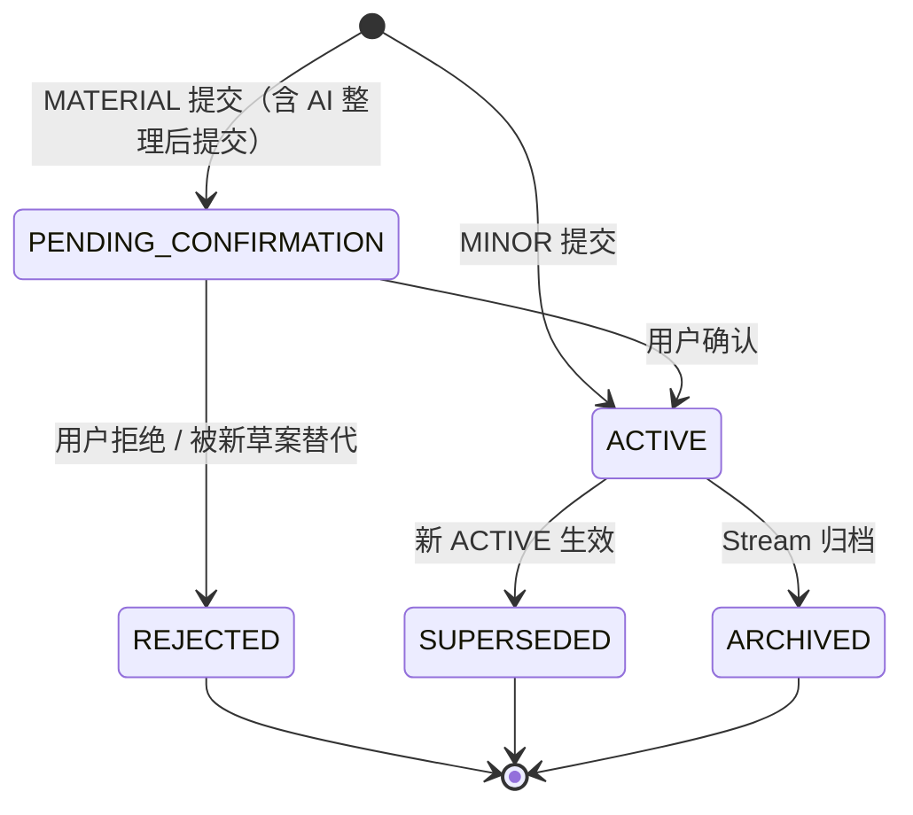

# 02 · Investment Thesis

> 状态：草案 v0.1
> 对应决策：D4（分级确认）、D13（对话记忆边界）、D14（正式变更边界）
> 一句话：**用户原话是事实，结构化内容是整理；AI 可以整理，不能替用户改口。**

---

## 1. 定位

Investment Thesis 统一承载用户对某个资产的目标、观点与约束，代替过去分散的「投资计划 + 市场观点」两个模块。

它必须同时满足三件事：

1. **低门槛**：用户只写一段自然语言也能用；不强迫理解 RSI/MACD。
2. **可审计**：每次变更是一个新版本，原话不丢，旧版本可查。
3. **可计算**：结构化字段可被 Agent 和程序读取，用于一致性判断、风险提示和决策上下文。

边界：

- Thesis 是**用户观点**，不是市场事实，也不是 AI 推断。
- Thesis 不是持仓；持仓由 Portfolio 子域独立维护。
- Thesis 不是聊天记录；对话内容不会自动进入 Thesis。
- Thesis 不是策略回测配置；v1 不支持程序化规则。

---

## 2. 结构化内容 Schema

`investment_theses.structured_content` 使用 JSON；金额/价格用**字符串**保存，应用层转 `Decimal`。

### 2.1 示例

```json
{
  "schema_version": "1.0",
  "thesis_statement": "短期可能回调至 65,000，中长期看涨；不因短期下跌清仓",
  "purpose": "长期配置，同时保留部分波段操作空间",
  "time_horizon": {
    "short_term": "WEEKS",
    "medium_term": "MONTHS",
    "long_term": "YEARS"
  },
  "market_outlook": {
    "short_term": "BEARISH",
    "medium_term": "NEUTRAL",
    "long_term": "BULLISH"
  },
  "scenarios": [
    {
      "id": "S1",
      "direction": "DOWN",
      "target_price": "65000",
      "target_currency": "USDT",
      "time_horizon": "SHORT_TERM",
      "status": "USER_EXPECTATION",
      "conditions": ["跌破 70,000 后成交量放大"],
      "invalidation": "周线重新站上 95,000"
    }
  ],
  "key_levels": {
    "support": ["64000", "70000"],
    "resistance": ["95000"],
    "watch": ["88000"]
  },
  "risk": {
    "max_drawdown_pct": "20",
    "max_position_pct": "50",
    "risk_budget_usd": "10000",
    "stop_loss_price": null,
    "take_profit_price": null
  },
  "position_intent": {
    "preferred_position_pct": "30",
    "allow_add": true,
    "allow_reduce": true,
    "avoid_full_exit": true
  },
  "constraints": [
    "不希望仅因短期下跌而完全离场",
    "不使用杠杆"
  ],
  "open_questions": [
    "如果跌破 60,000，论点是否仍然成立？"
  ],
  "notes": "目前更关注宏观流动性，而不是链上数据。"
}
```

### 2.2 字段说明

| 字段 | 类型 | 说明 | 空值 |
|---|---|---|---|
| `schema_version` | string | Schema 版本 | 必填 |
| `thesis_statement` | string | 一句话论点摘要，来自用户原话或用户确认的整理 | 可空字符串 |
| `purpose` | string \| null | 投资目的（长期配置/波段/观察） | 可空 |
| `time_horizon` | object | 短/中/长期的时间单位 | 可空对象 |
| `market_outlook` | object | 短/中/长期方向 | 可空对象 |
| `scenarios` | array | 用户预期的情景与目标价 | 可为空数组 |
| `key_levels` | object | 关注价位（支撑/阻力/观察） | 可为空 |
| `risk` | object | 风险预算与限制 | 可为空 |
| `position_intent` | object | 仓位意图，不是当前持仓 | 可为空 |
| `constraints` | string[] | 投资约束（自然语言） | 可为空数组 |
| `open_questions` | string[] | 用户当前关注的问题 | 可为空数组 |
| `notes` | string \| null | 补充说明 | 可空 |

枚举：

- `time_horizon.*`：`DAYS` / `WEEKS` / `MONTHS` / `YEARS`
- `market_outlook.*`：`BULLISH` / `NEUTRAL` / `BEARISH` / `UNCERTAIN`
- `scenarios[].direction`：`UP` / `DOWN` / `RANGE`
- `scenarios[].time_horizon`：`SHORT_TERM` / `MEDIUM_TERM` / `LONG_TERM`
- `scenarios[].status`：`USER_EXPECTATION` / `CONDITIONAL`

### 2.3 设计约束

- **不发明数字**：用户没说目标价，`target_price` 就是 `null`；用户没说风险预算，`risk` 字段留空。
- **不发明方向**：用户没说长期看涨，`long_term` 就是 `UNCERTAIN`，不是默认 `BULLISH`。
- **原文优先**：`thesis_statement` 是对原话的压缩，不是新策略；`original_text` 永远保留。
- **position_intent ≠ position**：这里写「希望仓位 30%」，不代表真实持仓 30%；真实持仓在 Portfolio。
- **可空**：观察型 Stream 可以只有 `original_text`，`structured_content` 为 `{}`。

---

## 3. MATERIAL 与 MINOR

### 3.1 判定表

| 路径 | 分类 | 理由 |
|---|---|---|
| `market_outlook.*` | **MATERIAL** | 方向改变会直接改变建议语义 |
| `time_horizon.*` | **MATERIAL** | 周期改变会改变「等待」还是「行动」 |
| `scenarios` 增删、`target_price`、`direction`、`time_horizon` | **MATERIAL** | 目标价是决策锚点 |
| `scenarios[].status` 改为 `INVALIDATED` | **MATERIAL** | 情景失效需要重新审视 |
| `risk.*` | **MATERIAL** | 风险预算是硬约束 |
| `position_intent.*` | **MATERIAL** | 仓位意图影响加减仓建议 |
| `constraints` 增删改 | **MATERIAL** | 约束是用户明确边界 |
| `thesis_statement` 改写 | MINOR | 摘要措辞，除非引入新的方向/价位（需重新解析） |
| `key_levels` | MINOR | 观察价位，不直接构成交易指令 |
| `purpose` / `notes` / `open_questions` | MINOR | 补充信息 |
| `structured_content` 从 `{}` 变为有值 | 按实际路径判定 | 观察型转正式观点 |

规则：

1. 先对 `structured_content` 做结构化 diff，命中的路径按表分类。
2. 任一 MATERIAL 字段变化 → 整个版本 `change_class = MATERIAL`。
3. 无 MATERIAL 变化 → `MINOR`。
4. **不确定时按 MATERIAL 处理**（安全默认）。
5. AI 解析若把「未识别段落」标记为包含方向/价位/风险，强制 MATERIAL 并要求澄清。
6. 用户只改 `original_text`、结构化内容不变 → `MINOR`（原文补充），但会保留旧版本。

### 3.2 确认规则

| change_class | 提交后状态 | 是否需要再次确认 | 生效方式 |
|---|---|---|---|
| `MATERIAL` | `PENDING_CONFIRMATION` | 是：展示 diff，点击「确认生效」 | 确认后原子切换 ACTIVE |
| `MINOR` | `ACTIVE` | 否 | 提交即生效，旧版本 SUPERSEDED |

补充：

- 即使是用户自己提交的 MATERIAL 变更，也要经过 diff 确认页；这是为了防止误触与「AI 整理后直接生效」。
- Agent 永远不能调用「确认」；确认接口只接受用户会话/本地管理令牌。
- 拒绝的版本保留为 `REJECTED`，不删除；下一次提交生成新版本号。
- 同一 Stream 同时只允许一个 `PENDING_CONFIRMATION`；新草案创建时，旧草案自动 `REJECTED`，备注「被新草案替代」。
- 确认时若当前 ACTIVE 版本已不是提交时的基准版本，返回 `409 STALE_THESIS`，要求重新提交（不做自动合并）。

---

## 4. 版本状态机



说明：

- `DRAFT` 状态保留给未来「编辑器自动保存」，v1.0 不使用。
- `ACTIVE` 同一 Stream 至多一个（部分唯一索引）。
- `SUPERSEDED` 与 `ARCHIVED` 仅用于历史查询，不进入 Agent 上下文。
- 版本号在写入时分配，允许因拒绝产生空号；顺序比连续性重要。

### 4.1 生效时间

- 确认时写入 `effective_from = now()`；旧版本 `effective_until = now()`。
- v1.0 不支持「未来生效」或「定时生效」；需要时由用户到点再确认。
- `confirmed_at` 与 `effective_from` 在 v1.0 相同；分开保留是为了未来支持预约生效。

---

## 5. AI 解析（THESIS_PARSE）

### 5.1 触发方式

只在 Thesis 编辑器中由用户显式点击「AI 帮我整理」触发。**对话窗口不触发解析，也不保存结果。**

流程：

```text
用户输入 natural language（编辑器 textarea）
  → 点击「AI 帮我整理」
  → AgentRun(task=THESIS_PARSE) 固定当前 ACTIVE 版本 + 原话
  → 返回结构化草案 + unparsed + clarifying_questions
  → 编辑器回填字段（用户可改）
  → 用户提交：按 MATERIAL/MINOR 规则生成版本
```

### 5.2 输出契约

```json
{
  "draft": { "...": "符合第 2 节 Schema" },
  "unparsed": [
    {"text": "如果宏观流动性收紧，我可能会重新考虑", "reason": "缺少可结构化字段"}
  ],
  "clarifying_questions": [
    "你说的「短期」大概是指几天、几周还是几个月？"
  ],
  "warnings": [
    "你提到 65,000 的回调目标，但没有说明该情景失效的条件"
  ]
}
```

规则：

- `draft` 必须通过 JSON Schema 校验；失败则整次解析失败，保留原文。
- `unparsed` 必须保留原文片段，不能丢弃用户表达。
- `clarifying_questions` 最多 5 条；问「缺什么」，不问「你觉得应该怎样」。
- 解析不得给出买卖建议，不得引入用户未提过的新策略。
- 解析不得把「我希望」写成「我已经」；不得把 AI 推断写入 `constraints`。
- 若用户原话包含明显矛盾（如「短期看涨」但目标价低于现价），写入 `warnings`，不擅自修正。

### 5.3 解析失败与降级

| 情况 | 行为 |
|---|---|
| 模型超时 | 30s 超时，提示重试；原文不丢 |
| JSON 不合法 | 重试 1 次；仍失败则提示「暂时无法整理，可直接手填」 |
| 结构化字段为空 | 合法：观察型论点，允许提交 |
| 用户取消 | 丢弃草案；不产生版本、不产生 AgentRun 之外的写入 |

---

## 6. Diff 与历史

### 6.1 Diff 结构

`diff_from_previous` 保存机器可读的变更：

```json
[
  {
    "op": "replace",
    "path": "/market_outlook/short_term",
    "before": "NEUTRAL",
    "after": "BEARISH",
    "classification": "MATERIAL"
  },
  {
    "op": "add",
    "path": "/scenarios/-",
    "before": null,
    "after": {
      "direction": "DOWN",
      "target_price": "65000",
      "time_horizon": "SHORT_TERM"
    },
    "classification": "MATERIAL"
  },
  {
    "op": "replace",
    "path": "/notes",
    "before": "关注 ETF 流入",
    "after": "关注 ETF 流入与宏观流动性",
    "classification": "MINOR"
  }
]
```

### 6.2 历史视图

- 版本列表：版本号、状态、来源、`change_class`、生效时间、变更摘要。
- 版本详情：原文、结构化内容、diff、`source_agent_run_id`、确认时间。
- 任意两版本对比：并排 diff；默认对比上一版。
- 旧版本不能删除；可以归档 Stream。

---

## 7. 与对话、监控的关系

### 7.1 对话

- 对话**只读** Thesis：`get_investment_thesis` 只返回 ACTIVE 版本；`get_thesis_history` 返回历史。
- 用户说「帮我改成看空」→ 对话不能写，只能解释并指出编辑器路径。
- 对话可以引用「你当前 v3 说……」，但不能说「我已经帮你改成 v4」。
- 对话中的观点变化不会自动成为版本；这是 D13/D14 的硬边界。

### 7.2 定时分析

- 每次 `MONITOR_ANALYSIS` 固定当次 ACTIVE 版本 ID；运行中 Thesis 变化不影响本次上下文。
- 下一轮使用新版本，并在 `changes_since_previous` 中解释版本差异。
- 没有 ACTIVE 版本（观察型）时，Agent 只能基于行情与持仓分析，明确声明「没有正式论点」。

### 7.3 Proposal（v1.2+）

- v1.0 不产生 Proposal；AI 草案在编辑器中回填，确认后直接生成版本。
- 未来渠道写操作时，Proposal 才承载「待确认的 Thesis 变更」；确认后仍走本节的版本写入规则。

---

## 8. 校验规则

### 8.1 Schema 校验

- `schema_version` 必填且受支持。
- 金额/价格字符串必须能解析为 `Decimal`，且 `> 0`。
- 百分比字段 `0 <= x <= 100`。
- `scenarios[].id` 在数组内唯一。
- `target_currency` 默认等于 Instrument 的 `quote_currency`；不一致时 warning。
- `max_position_pct` 与 `preferred_position_pct` 不强制大小关系，但若 preferred > max 给 warning。

### 8.2 语义警告（不阻断保存）

| 情况 | 处理 |
|---|---|
| 短期 `BEARISH` 但目标价高于现价 | warning：「方向与目标价可能不一致」 |
| `DOWN` 情景目标价高于现价 | warning |
| `UP` 情景目标价低于现价 | warning |
| 有 `scenarios` 但没有 `invalidation` | warning：「建议补充失效条件」 |
| `risk` 全空 | warning：「未设置风险预算，建议补充」 |
| `constraints` 含「不使用杠杆」但 `position_intent` 无对应 | 不处理（自然语言约束由 Agent 解释） |

警告只展示给用户，不自动修改字段。

### 8.3 原文校验

- `original_text` 非空，长度 1–20,000 字符。
- 提交时保存原文快照；后续编辑生成新版本，不 UPDATE 旧原文。
- 原文中的 HTML/脚本按纯文本处理；前端转义渲染。

---

## 9. API 轮廓

详细见 `05-api.md`。

| 方法 | 路径 | 说明 |
|---|---|---|
| GET | `/streams/{id}/thesis` | 当前 ACTIVE 版本 + 结构化内容 |
| GET | `/streams/{id}/thesis/versions` | 版本列表（分页） |
| GET | `/thesis/versions/{id}` | 版本详情 |
| GET | `/thesis/versions/{id}/diff?against={other}` | 版本对比 |
| POST | `/streams/{id}/thesis/parse` | AI 整理，返回草案；不落库 |
| POST | `/streams/{id}/thesis/versions` | 提交新版本（MATERIAL → PENDING） |
| POST | `/thesis/versions/{id}/confirm` | 确认 MATERIAL 版本 |
| POST | `/thesis/versions/{id}/reject` | 拒绝 |
| PATCH | `/thesis/versions/{id}` | 编辑尚未确认的版本（仅 PENDING） |

---

## 10. 示例：从原话到版本

### 10.1 用户输入

> 我认为 BTC 短期可能转空，预计回调至 65,000 附近；但中长期依然看涨，认为回调可能是下一轮上涨的机会。目前不希望因为短期下跌就完全离场，也不使用杠杆。

### 10.2 解析结果

```json
{
  "schema_version": "1.0",
  "thesis_statement": "短期可能回调至 65,000，中长期看涨；不因短期下跌清仓，不使用杠杆",
  "time_horizon": {
    "short_term": "WEEKS",
    "medium_term": "MONTHS",
    "long_term": "YEARS"
  },
  "market_outlook": {
    "short_term": "BEARISH",
    "medium_term": "NEUTRAL",
    "long_term": "BULLISH"
  },
  "scenarios": [
    {
      "id": "S1",
      "direction": "DOWN",
      "target_price": "65000",
      "target_currency": "USDT",
      "time_horizon": "SHORT_TERM",
      "status": "USER_EXPECTATION",
      "conditions": [],
      "invalidation": null
    }
  ],
  "constraints": [
    "不希望仅因短期下跌而完全离场",
    "不使用杠杆"
  ],
  "risk": {},
  "position_intent": {},
  "key_levels": {},
  "open_questions": [],
  "notes": null
}
```

### 10.3 版本记录

- `source = AGENT`（结构化由 AI 整理），`source_agent_run_id` 指向解析 Run；
- `change_class = MATERIAL`（新增下行情景、方向、约束）；
- 首次版本：`version = 1`，`status = PENDING_CONFIRMATION`；
- 用户确认后 `ACTIVE`，`confirmed_at = now()`；
- 下一轮监控固定 `thesis_version_id = v1`。

---

## 11. 开放问题

| # | 问题 | 当前默认 |
|---|---|---|
| T1 | `key_levels` 是否应算 MATERIAL？ | v1 算 MINOR；若用户反对再改 |
| T2 | 是否允许未来生效时间？ | v1 不允许 |
| T3 | 是否允许多个 PENDING 草案？ | 不允许，只保留一个 |
| T4 | AI 解析的 `field_confidence` 是否展示？ | v1 不展示，只展示 warnings |
| T5 | 观察型 Stream 是否需要强制填写 `thesis_statement`？ | 不需要，允许只有原文 |