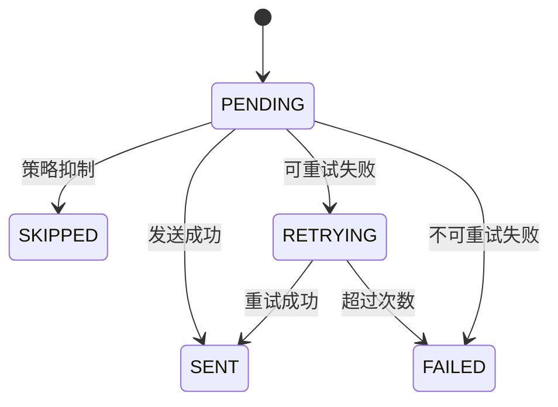

# 04 · Decision 与通知

> 状态：草案 v0.1
> 对应决策：D5（只发重要变化）、D15（语气边界）、D19（合约观察）、D22（合约建议）
> 一句话：**Decision 是程序可校验的结构化建议；是否打扰用户，由程序按规则决定，不由模型决定。**

---

## 1. Decision 是什么

- 一次 `MONITOR_ANALYSIS` Agent Run 的**结构化结论**，一个 Run 至多一个 Decision（1:1）。
- 只给建议，不执行交易，不修改持仓，不修改 Thesis。
- 只追加，不 UPDATE；结论变化必须产生新的 Run + Decision。
- 对话任务**不产生 Decision**；用户问「现在该怎么办」时，对话引用最近一次 Decision，并给出只读分析。
- `confidence` 是模型自评的把握程度，**不是校准过的胜率**；UI 必须标注这一点。

---

## 2. 决策枚举

首版只支持 BTC 现货多头/空仓，枚举语义按此定义：

| 枚举 | 含义 | 典型场景 |
|---|---|---|
| `BUY` | 建议建立或增加多头敞口 | 空仓/低仓，论点与行情支持建仓 |
| `SELL` | 建议卖出或减少多头敞口 | 观点转空、论点失效、达到退出条件 |
| `REDUCE` | 建议降低风险敞口，但不一定看空 | 波动上升、仓位超过风险预算、锁定部分利润 |
| `HOLD` | 维持当前仓位，不做新动作 | 论点未变、行情在预期范围内 |
| `WAIT` | 暂不行动，等待更多信息 | 信号不明确、数据不足、刚经历大幅波动 |
| `REVIEW` | 前提或数据发生重大变化，需要用户重新审视计划/Thesis | 关键价位失效、论点冲突、数据质量不足 |

`SELL` 与 `REDUCE` 的区别：

- `SELL`：**观点驱动**——你认为方向变了，应该退出/大幅减仓。
- `REDUCE`：**风险驱动**——观点可能没变，但仓位/波动/预算要求你降风险。

有永续持仓时，`decision` 表示整体立场，具体动作放 `derivative_recommendation`。例如现货 HOLD、永续 REDUCE_LONG，整体可以是 REDUCE。两者不能自相矛盾。

`HOLD` 与 `WAIT` 的区别：

- `HOLD`：有仓位，维持不动。
- `WAIT`：不行动，常用于空仓观察或信号不明；不暗示「应该买」。

---

## 3. 优先级

| 优先级 | 含义 | 是否默认通知 |
|---|---|---|
| `LOW` | 信息性，无行动必要 | 否 |
| `NORMAL` | 常规建议，可看可不看 | 否（除非类别跃迁） |
| `HIGH` | 重要变化：类别跃迁、alignment 恶化、接近风险阈值 | 是 |
| `URGENT` | 需要尽快关注：失效条件触发、风险预算被突破、极端行情 | 是（可绕过免打扰） |

模型给出 `priority` 建议，程序可以**升级**（例如失效条件触发时强制 HIGH/URGENT），但不能因为模型说「紧急」就无条件发送。

---

## 4. Decision Schema v1

### 4.1 完整示例

```json
{
  "schema_version": "v1",
  "decision": "WAIT",
  "confidence": 0.68,
  "priority": "NORMAL",
  "summary": "短期趋势仍偏弱，4h 动能未确认，暂不建议增加仓位。",
  "evidence_for": [
    {
      "claim": "4h MACD 柱连续 3 根收缩，动能减弱",
      "kind": "FACT",
      "source_tool": "get_technical_indicators",
      "as_of": "2026-11-14T15:00:00Z",
      "strength": "MODERATE"
    }
  ],
  "evidence_against": [
    {
      "claim": "价格仍站在 4h EMA20 上方，中期结构未破",
      "kind": "FACT",
      "source_tool": "get_technical_indicators",
      "as_of": "2026-11-14T15:00:00Z",
      "strength": "MODERATE"
    }
  ],
  "thesis_alignment": {
    "status": "PARTIALLY_ALIGNED",
    "explanation": "短期偏弱符合用户回调预期；但尚未触及 65,000 目标区，不能确认中长期机会。",
    "conflicting_fields": []
  },
  "position_impact": {
    "assessment": "EXISTING_POSITION_EXPOSED_TO_DOWNSIDE",
    "exposure_usd": "45620.00",
    "unrealized_pnl_usd": "4620.00",
    "risk_budget_usage_pct": "42.0",
    "notes": "仓位在风险预算内，但浮盈回撤空间有限。"
  },
  "derivative_recommendation": {
    "action": "HOLD",
    "size_change_pct": null,
    "rationale": "永续仓位维持，等待 4h 动能确认；清算缓冲仍在用户约束内。",
    "invalidation_conditions": []
  },
  "changes_since_previous": [
    {
      "field": "decision",
      "before": "HOLD",
      "after": "WAIT",
      "reason": "4h 动能转弱，等待确认"
    }
  ],
  "invalidation_conditions": [
    {
      "condition": "周线收盘跌破 70,000",
      "threshold": "70000",
      "monitorable": true
    },
    {
      "condition": "4h 放量突破 95,000 并站稳",
      "threshold": "95000",
      "monitorable": true
    }
  ],
  "data_quality": {
    "status": "GOOD",
    "missing": [],
    "staleness": "FRESH",
    "as_of": "2026-11-14T15:00:00Z"
  },
  "notification_recommendation": {
    "notify": false,
    "reason": "结论与上轮接近，未达到重要变化阈值",
    "suggested_priority": "NORMAL"
  }
}
```

### 4.2 字段约束

| 字段 | 类型 | 约束 |
|---|---|---|
| `schema_version` | string | 必填，当前 `v1` |
| `decision` | enum | `BUY/SELL/HOLD/REDUCE/WAIT/REVIEW` |
| `confidence` | number | `0 <= x <= 1`；不是胜率 |
| `priority` | enum | `LOW/NORMAL/HIGH/URGENT` |
| `summary` | string | 10–500 字符，中文，先结论 |
| `evidence_for` | array | 至少 1 条（数据不足时可为空并说明） |
| `evidence_against` | array | 可为空，但不能与 `evidence_for` 重复 |
| `thesis_alignment` | object | `status` 必填 |
| `position_impact` | object | `assessment` 必填 |
| `derivative_recommendation` | object | 有永续持仓时必填；动作需匹配方向；无持仓可省略或 `NONE` |
| `changes_since_previous` | array | 无变化时为 `[]`；不得虚构变化 |
| `invalidation_conditions` | array | `BUY/SELL/REDUCE` 至少 1 条 |
| `data_quality` | object | `status` 必填 |
| `notification_recommendation` | object | 仅建议；程序裁决 |

### 4.3 Evidence 结构

```json
{
  "claim": "一句可核验的事实或推断",
  "kind": "FACT | INFERENCE",
  "source_tool": "get_asset_overview",
  "as_of": "2026-11-14T15:00:00Z",
  "strength": "STRONG | MODERATE | WEAK"
}
```

- `FACT` 必须能对应到工具结果；`INFERENCE` 必须标明是推断。
- `as_of` 与工具结果的 `as_of` 一致；没有时间戳的 evidence 视为无效。
- 不允许把「新闻/宏观」写成事实（v1 无新闻工具）；只能写用户 Thesis 或行情事实。

### 4.4 Thesis Alignment

| status | 含义 |
|---|---|
| `ALIGNED` | 建议与当前 Thesis 的方向、周期、约束一致 |
| `PARTIALLY_ALIGNED` | 部分一致，存在需要说明的差异 |
| `CONFLICTING` | 与 Thesis 明确冲突（例如 Thesis 看涨但建议 SELL） |
| `UNKNOWN` | 没有 ACTIVE Thesis 或无法判断 |

`conflicting_fields` 用结构化路径，如 `["market_outlook.short_term"]`。

### 4.5 Position Impact

| assessment | 含义 |
|---|---|
| `NO_POSITION` | 空仓/观察 |
| `EXISTING_POSITION_ALIGNED` | 持仓与建议一致，无需调整 |
| `EXISTING_POSITION_EXPOSED_TO_DOWNSIDE` | 持仓面临下行风险 |
| `EXISTING_POSITION_UNDERUTILIZED` | 仓位低于论点允许的配置 |
| `RISK_BUDGET_EXCEEDED` | 超过用户风险预算 |

数值字段用字符串 Decimal；由程序计算后注入上下文，模型只解释，不重算。

### 4.6 Data Quality

| status | 含义 | 允许的决策 |
|---|---|---|
| `GOOD` | 必要数据齐全且新鲜 | 全部 |
| `DEGRADED` | 部分数据缺失/过期，仍可有限分析 | `HOLD/WAIT/REDUCE/REVIEW`；`BUY/SELL` 需显著降低 confidence |
| `INSUFFICIENT` | 无法可靠分析 | 仅 `WAIT/REVIEW`，`confidence <= 0.5`，不通知 |

### 4.7 Derivative Recommendation

只在 USDT 本位永续持仓存在时要求；无持仓时可省略或为 `NONE`。

```json
{
  "action": "REDUCE_LONG",
  "size_change_pct": "25",
  "rationale": "仓位接近用户 max_leverage，且距清算价缓冲低于 30%",
  "invalidation_conditions": [
    "4h 收盘重新站上 95,000"
  ]
}
```

| action | 含义 | 前置条件 |
|---|---|---|
| `OPEN_LONG` | 开多 | 当前无永续持仓 |
| `INCREASE_LONG` | 加多 | 当前 LONG |
| `REDUCE_LONG` | 减多 | 当前 LONG，`size_change_pct` 必填 |
| `CLOSE_LONG` | 平多 | 当前 LONG |
| `OPEN_SHORT` | 开空 | 当前无永续持仓，且 Thesis 允许做空 |
| `INCREASE_SHORT` | 加空 | 当前 SHORT |
| `REDUCE_SHORT` | 减空 | 当前 SHORT，`size_change_pct` 必填 |
| `CLOSE_SHORT` | 平空 | 当前 SHORT |
| `ADJUST_MARGIN` | 调整保证金 | 当前有持仓；`rationale` 必填 |
| `HOLD` | 维持 | 当前有持仓 |
| `NONE` | 不涉及永续 | 当前无持仓 |

校验：

- 单向持仓；同一轮不得同时出现多空动作。
- 动作必须匹配当前方向；`OPEN_*` 只在无持仓时允许；`CLOSE_*` 必须有持仓。
- `size_change_pct` 在 `0–100`；`REDUCE_*` 必填，`INCREASE_*` 可选（默认按建议仓位）。
- **不得输出估算清算价**；只能引用用户录入的 `liquidation_price`。用户未填时，风险指标为空，`rationale` 必须说明“清算价未提供”。
- `derivative_intent.allow_perpetual=false` 时，`OPEN_*`/`INCREASE_*` 视为与 Thesis 冲突，整体 decision 应为 `REVIEW`。
- `OPEN_SHORT`/`INCREASE_SHORT` 需要 `derivative_intent.allow_short=true`；否则 `REVIEW`。
- 非 `HOLD/NONE` 的合约建议默认 `priority >= HIGH`，进入通知策略。
- 有永续持仓但缺少 `derivative_recommendation` → Schema 校验失败，要求重生成。

---

## 5. 程序侧校验与业务规则

### 5.1 硬校验

- JSON 解析成功、Schema 校验通过。
- 枚举合法、数值范围合法、字符串长度合法。
- `evidence[*].as_of` 不得晚于 Run 的 `finished_at`，不得不早于行情快照时间太多（避免引用旧数据）。
- `changes_since_previous` 的 `before` 必须等于上一条 Decision 的对应字段；否则视为幻觉，要求重生成。
- `invalidation_conditions` 的 threshold 必须来自上下文（用户 Thesis 或行情），不得编造。
- `data_quality.status=INSUFFICIENT` → 强制 `decision ∈ {WAIT, REVIEW}`、`confidence <= 0.5`、`notify=false`。
- 有永续持仓时，`derivative_recommendation` 必须存在；动作必须匹配当前方向；`OPEN_*`/`CLOSE_*` 前置条件必须成立；不得引用估算清算价。

### 5.2 软校验（记录 warning，不阻断）

| 情况 | 处理 |
|---|---|
| `thesis_alignment=CONFLICTING` 且 `decision ∈ {BUY, SELL}` | warning；要求 explanation 非空；通知策略降级 |
| `BUY` 但 `position_impact=RISK_BUDGET_EXCEEDED` | warning；通知策略强制 HIGH |
| `confidence > 0.9` | warning；UI 提示「模型自评，不是胜率」 |
| `evidence_for` 全为 `INFERENCE` | warning；降低通知优先级 |
| 合约动作非 `HOLD/NONE` 但 `priority < HIGH` | 程序提升为 HIGH |
| 有永续持仓但用户未填清算价 | warning；风险指标显示“未提供”，不阻止建议 |
| `summary` 含「保证/稳赚/一定」 | 重生成或拒绝 |

### 5.3 反抖动

- 每轮必须读取上一条 Decision，并说明「变了什么 / 为什么没变」。
- 不允许每小时无条件翻转结论；若结论变化，`changes_since_previous` 必须给出具体触发。
- 相同 `decision` + 相同 `thesis_alignment` + 相似 `summary`（长度/关键词）→ 视为无实质变化。
- 程序可对「连续两次相反结论」要求下一次 Run 先给 `REVIEW`，避免来回打脸（v1 记录 warning，不强制）。

---

## 6. 通知策略（程序裁决）

### 6.1 流程

```text
Decision 落库
  → NotificationPolicy.evaluate(decision, prefs, history, now)
  → 生成 notifications(PENDING/SKIPPED) + dedupe_key
  → 若 PENDING：入队 NOTIFICATION_SEND
  → 发送（Email / Feishu）
  → notification_deliveries 记录成功/失败/重试
```

LLM 的 `notification_recommendation` 只是输入之一；最终由程序规则决定，并记录 `override_reason`。

### 6.2 触发规则

满足任一「通知条件」：

| # | 条件 | 说明 |
|---|---|---|
| N1 | `priority ∈ {HIGH, URGENT}` | 重要建议 |
| N2 | 决策类别跃迁 | 如 `WAIT→BUY`、`HOLD→SELL`、`BUY→REDUCE` |
| N3 | `thesis_alignment` 从非 `CONFLICTING` 变为 `CONFLICTING` | 论点冲突恶化 |
| N4 | `invalidation_conditions` 被触发 | 需要用户重新审视计划 |
| N5 | `position_impact=RISK_BUDGET_EXCEEDED` | 风险预算被突破 |

抑制条件（任一命中则不通知）：

| # | 条件 | 说明 |
|---|---|---|
| S1 | 4 小时内已有同 `dedupe_key` 通知 | 冷却 |
| S2 | `data_quality=INSUFFICIENT` | 数据不足，不打扰 |
| S3 | 与上一条通知的 decision/alignment/priority 完全相同 | 去重 |
| S4 | 处于用户免打扰时段且非 URGENT | 默认 23:00–08:00（Stream 时区） |
| S5 | 用户关闭该类型通知 | 偏好优先 |
| S6 | 当日邮件数 ≥ 4 | 防轰炸 |

### 6.3 Dedupe Key

```text
dedupe_key = sha256(
  stream_id | decision | priority | thesis_alignment.status |
  sorted(invalidation_conditions triggered ids)
)
```

- 相同 key 在 4 小时冷却窗口内只发一次。
- 不同 key 但内容高度相似（同 decision + 同 alignment + summary 相似度 > 0.8）→ 也抑制。
- 冷却窗口与每日上限可配置；默认 4h / 4 封。

### 6.4 用户偏好

- `decision_alert_enabled`（默认 true）
- `risk_alert_enabled`（默认 true）
- `daily_summary_enabled`（默认 false）
- `quiet_hours`（默认 23:00–08:00，URGENT 可绕过）
- `email_verified_at`
- `feishu_push_enabled`（v1.1，默认 true，仅摘要）

### 6.5 决策 → 通知映射

| Decision | 默认优先级 | 默认通知 | 备注 |
|---|---|---|---|
| `WAIT` | NORMAL | 否 | 除非类别跃迁或 REVIEW |
| `HOLD` | NORMAL | 否 | 除非 alignment 恶化 |
| `BUY` | HIGH | 是 | 首次建仓建议属于重要变化 |
| `SELL` | HIGH | 是 | 方向性退出 |
| `REDUCE` | HIGH | 是 | 风险动作 |
| `REVIEW` | HIGH | 是 | 前提变化，需要用户重新审视 |
| 合约动作（非 `HOLD/NONE`） | HIGH | 是 | 开/平/加减合约，或调保证金 |

模型可建议 `URGENT`；程序仅在「失效条件触发 + 数据 GOOD」时接受。

---

## 7. 通知状态机与重试



- 重试：3 次，退避 1m / 5m / 30m。
- 永久失败：记录 `FAILED`，Web 通知中心显示；不静默丢失。
- 邮件发送成功以 SMTP 接受为准；不追踪打开率（v1）。
- 每个通知可有多个 delivery（EMAIL/FEISHU），任一成功即通知成功，但分别记录。

---

## 8. 邮件

### 8.1 配置与验证

- SMTP host/port/username/password（加密）/from。
- 设置页「发送测试邮件」；成功记录 `email_verified_at`。
- v1 单用户，不做退订链接；提供关闭通知开关。

### 8.2 模板

主题：

```text
[Thesium] BTC · HIGH · 建议减仓（2026-11-14 15:00）
```

正文结构：

1. 一句话结论；
2. Decision / 优先级 / 模型自评置信度（标注非胜率）；
3. 支持与反对证据（各 1–3 条，带数据时间）；
4. 与 Thesis 的关系；
5. 持仓影响（数量、浮盈、预算占用）；
6. 失效条件；
7. 数据质量与时间戳；
8. 查看详情链接；
9. 免责声明：「仅供个人参考，不构成投资建议；不执行任何交易。」

要求：纯文本 + HTML 两版；不嵌入外部追踪像素；不包含 API Key/完整 Prompt。

---

## 9. 飞书推送（v1.1）

- 仅推送**摘要**：decision、priority、一句话 summary、数据时间、Web 链接。
- 不默认推送完整持仓数量与成本；用户可在飞书问细节（只读对话）。
- 与邮件共用 `notification_deliveries`，channel=`FEISHU`。
- 同一策略、同一冷却；默认只推 HIGH/URGENT。
- 用户可在 Web 关闭 Feishu 推送，或撤销绑定。

---

## 10. 示例：为什么这条不通知

```text
上轮：WAIT / NORMAL / PARTIALLY_ALIGNED
本轮：WAIT / NORMAL / PARTIALLY_ALIGNED
summary 相似，无失效条件触发
→ S3 抑制；notify=false
```

## 11. 示例：为什么这条通知

```text
上轮：HOLD / NORMAL / ALIGNED
本轮：REDUCE / HIGH / PARTIALLY_ALIGNED
原因：仓位超过用户 max_position_pct，且 4h 波动率上升
→ N1 + N5 触发；冷却窗口外；data_quality=GOOD
→ 发邮件（+ 飞书，若开启）
```

---

## 12. 验收场景

1. 普通 `WAIT` 连续 5 轮 → 0 封邮件。
2. `HOLD → SELL` 且 HIGH → 1 封邮件；4 小时内再次 `SELL` → 不发。
3. 数据 `STALE` 导致 `REVIEW` → 邮件标注数据过期，不写「实时」。
4. 风险预算被突破 → 强制 HIGH，即使模型建议 NORMAL。
5. 用户关闭 `decision_alert_enabled` → 所有决策通知 SKIPPED，但 Web 时间线仍显示。
6. 邮件失败 → 重试 3 次 → FAILED，Web 可见。
7. 飞书绑定后 HIGH 决策 → 收到摘要；未绑定 → 不发。
8. `confidence=0.95` 的邮件仍标注「模型自评，非胜率」。

---

## 13. 开放问题

| # | 问题 | 当前默认 |
|---|---|---|
| D1 | 每日上限 4 封是否合适？ | 是，可配置 |
| D2 | URGENT 是否绕过免打扰？ | 是 |
| D3 | 是否允许用户自定义通知关键词？ | v1 不做 |
| D4 | 飞书是否默认开启推送？ | 是，仅摘要，可关 |
| D5 | 是否追踪邮件打开率？ | 否 |