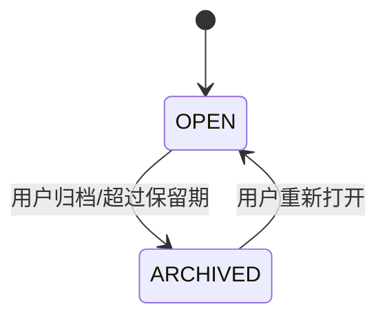
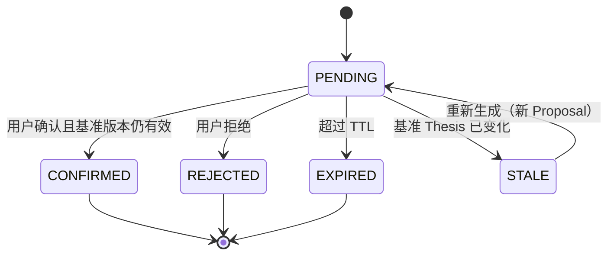
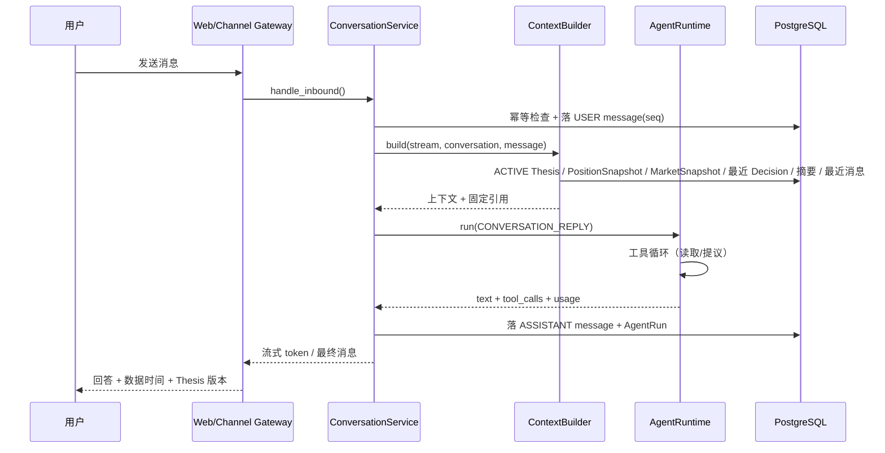
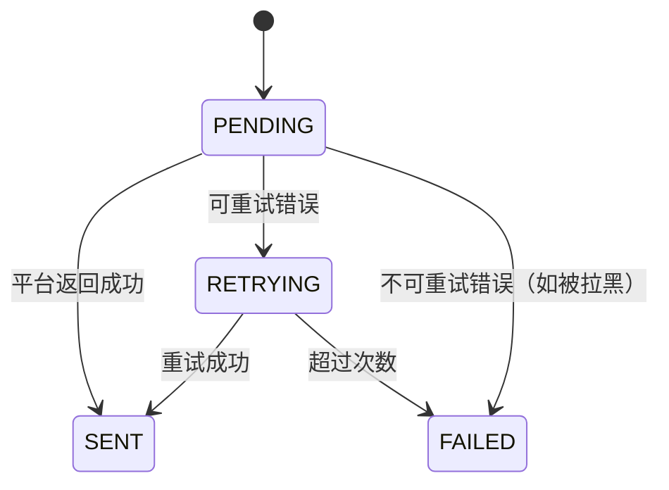

# 07 · 对话与多渠道接入

> 状态：草案 v0.1（待确认）
> 对应决策：`00-decisions.md` D9–D14
> 一句话：**对话是思考空间，Thesis 是承诺；渠道只是运输方式。**

---

## 7.1 产品判断

用户提出两件事：

1. 一个围绕某个资产、就当前价格/趋势/策略连续讨论的**对话窗口**；
2. 把同样的能力通过**微信/飞书机器人**延伸到手机，解决外出时打不开网页的问题。

这两件事很容易被做成「再接一个通用聊天机器人」。但那会稀释产品最重要的差异点——**可审计**。因此本设计先立三条边界：

### 边界一：对话不是通用助手，是「对 Thesis 的盘问」

对话永远锚定在一个 Investment Stream（首版即 BTC）上。它回答的是：

- 现在价格/趋势发生了什么？数据是什么时间点的？
- 和我当前的投资论点还一致吗？哪里一致、哪里冲突？
- 如果发生某种情景（跌到 X、突破 Y），我的论点/仓位意味着什么？
- 我改口之后，之前的判断哪些失效、哪些仍成立？

它不回答：与持仓无关的通用问题、实时新闻（v1 无新闻）、交易执行、其他用户的资产。

### 边界二：聊天可以建议，但不能替用户「定稿」

聊天中用户说「我短期看空到 65,000」，Agent 可以整理成 Thesis 变更草案，但必须走 Proposal → 用户确认 → 新版本。详见 7.4 与 7.10。

### 边界三：渠道是传输层，不是第二个产品

Web、飞书、未来的企业微信共用同一个 `ConversationService` 和 `AgentRuntime`。渠道适配器只做四件事：验签、解析入站、发送出站、记录投递。它不拼 Prompt、不读数据库、不做业务判断。

> 如果哪天发现「飞书里的回答和网页里的回答不一样」，那不是渠道 bug，而是架构已经分叉了。

---

## 7.2 目标与非目标

| | 内容 |
|---|---|
| **目标** | 单 Stream 内多轮对话；引用实时行情/指标/持仓/Thesis/历史决策；回答可追溯到 Agent Run；支持 Web 流式对话；支持飞书 1:1 远程对话；观点/持仓变更走 Proposal + 确认；IM 可接收重要决策推送 |
| **非目标（v1）** | 群聊、语音、图片/文件理解、通用百科问答、实时新闻、自动交易、个人微信桥接、多用户共享会话、跨 Stream 对话、聊天内容自动写入正式观点 |
| **后续可加** | 飞书交互卡片按钮确认、企业微信/公众号适配器、按需触发完整分析、MCP 出口、对话导出 PDF/Markdown |

---

## 7.3 一个 Runtime，两种任务

| 维度 | `MONITOR_ANALYSIS` | `CONVERSATION_REPLY` | `THESIS_PARSE` |
|---|---|---|---|
| 发起者 | Scheduler | 用户（Web/IM） | 用户提交自然语言 |
| 输出 | 结构化 Decision JSON | 自然语言（可流式） | 结构化 Thesis 草案 |
| 是否保存 Decision | 是（1:1） | 否（只存 Agent Run + Message） | 否（产出 Proposal） |
| 上下文 | 完整分析上下文 | Stream brief + 摘要 + 最近消息 | 原文 + 当前 Thesis |
| 工具 | 读取 + 保存观察 + 提议通知 | 读取 + 提议变更 | 无或仅读取 |
| 流式 | 否 | 是（Web SSE） | 否 |
| 触发通知 | 可能 | 否 | 否 |

**为什么共用 Runtime**：

- 同一份持仓/论点必须有同一口径；
- 工具权限矩阵只维护一份；
- 每次对话都能落到 `agent_runs`，与 Decision 共享可追溯链；
- 模型 Provider、Prompt 版本、安全规则只配置一次。

**Runtime 需要抽象出的能力**：

```python
@dataclass(frozen=True)
class AgentTask:
    stream_id: UUID
    task_type: Literal["MONITOR_ANALYSIS", "CONVERSATION_REPLY", "THESIS_PARSE"]
    conversation_id: UUID | None = None
    user_message_id: UUID | None = None
    output_schema: type[BaseModel] | None = None   # 结构化任务用
    stream: bool = False

class AgentRuntime(Protocol):
    async def run(self, task: AgentTask) -> AgentResult: ...
```

`AgentResult` 至少包含：`run_id`、`text`、`parsed`、`tool_calls`、`usage`、`pinned_refs`（thesis/position/market 版本）。

---

## 7.4 对话域与生命周期

### 7.4.1 聚合

- `Conversation`：归属 Stream；渠道 + 外部线程唯一（Web 一个 Stream 默认一个 OPEN 会话）。
- `ConversationMessage`：只追加；`seq` 单调；用户消息可带 `external_message_id` 做幂等。
- `Proposal`：变更意图；`PENDING → CONFIRMED / REJECTED / EXPIRED / STALE`。
- `ChannelBinding` / `PairingCode` / `Delivery`：身份与投递，见 7.8–7.10。

### 7.4.2 对话状态



对话本身没有「已确认」状态；**确认发生在 Proposal 上**，而不是整段对话上。

### 7.4.3 Proposal 状态机



规则：

- 每个 Proposal 有 `base_thesis_version_id`；确认时重读当前 ACTIVE 版本，不一致则 `STALE`。
- 不做自动合并（避免 AI 猜测用户意图）；提示用户「观点已更新，请重新生成」。
- 确认动作是领域服务，不是模型；模型只创建 Proposal。
- 确认/拒绝/过期都写 `audit_logs`。

### 7.4.4 一次对话的时序



---

## 7.5 上下文装配

### 7.5.1 预算

以 8k–10k tokens 上下文为目标（按用户配置模型调整）：

| 块 | 预算 | 内容 |
|---|---|---|
| System | ~1.2k | 角色、事实边界、安全规则、输出风格、禁止事项 |
| Stream brief | ~1.5k | 资产、当前报价、涨跌、数据时间与新鲜度、持仓摘要、风险摘要 |
| Thesis | ~1.2k | ACTIVE 版本原文 + 结构化摘要 + 版本号 |
| 最近决策 | ~0.8k | 最近 3 条：decision、summary、priority、时间 |
| 对话摘要 | ~0.5k | 滚动摘要（非全量历史） |
| 最近消息 | ~2.5k | 最近 12 条，按 token 截断 |
| 工具结果 | ~2k | 单次截断，总预算控制 |
| 预留 | ~1k | 输出与工具循环 |

### 7.5.2 包含 / 不包含

**包含**：

- 当前 ACTIVE Thesis（原文 + 结构化 + 版本 + 生效时间）；
- 最新 PositionSnapshot 与风险数值（程序算好，不交给模型算）；
- 最新 MarketSnapshot（价格、24h、指标、`market_time`、`fetched_at`、`staleness`）；
- 最近 3 条 Decision（含上轮结论与变化原因）；
- 该对话的滚动摘要 + 最近消息；
- 用户的当前问题。

**不包含**：

- 其他 Stream 的任何数据；
- 全量历史聊天记录（用摘要 + 窗口）；
- 原始 K 线全量（只给指标与最近收盘，工具按需取）；
- 新闻原文（v1 无）；
- API Key、系统 Prompt、其他用户数据；
- 未确认的 Thesis 草案（除非用户正在确认流程中）。

### 7.5.3 Stream brief 示例

```text
[资产] BTC/USDT · Binance 现货
[行情] 91,240 USDT · 24h +1.8% · market_time=2026-11-14T15:00:00Z · fetched_at=15:00:12Z · FRESH
[指标] 1h RSI14=58.2 · 4h EMA20=89,800 · 4h MACD 柱=+120 · 1d 趋势=UP
[持仓] 0.5 BTC · 均价 82,000 · 浮盈 +4,620 USDT (+11.3%) · 仓位市值 45,620 USDT
[论点] v3（2026-11-10 生效）：短期可能回调至 65,000，中长期看涨；不希望因短期下跌清仓
[最近决策] 11-14 14:00 WAIT / NORMAL：“短期偏弱，等待确认”
[数据质量] GOOD（无缺失）
```

这段 brief 由程序生成，数字不允许模型自行推算或改写。

### 7.5.4 滚动摘要

- 触发：消息数 > 24 或消息 token > 3k。
- 将 `summary_through_seq` 之前的消息压缩为 300–500 字摘要，记录新摘要到 `conversations.rolling_summary`。
- 摘要只服务该对话；不进入定时分析。
- 摘要生成失败不阻塞对话，退化为窗口截断，并标记 `summary_failed_at`。

### 7.5.5 数据新鲜度

- 所有行情工具返回都带 `market_time` / `fetched_at` / `staleness`。
- `STALE` 或 `UNKNOWN` 时，System Prompt 要求：明确说明数据过期、降低结论强度、不得给出精确买卖点。
- UI 与 IM 回复都带数据时间；没有时间戳的价格视为 bug。

---

## 7.6 工具与权限矩阵

| 工具 | MONITOR | WEB CHAT | IM CHAT | 说明 |
|---|---|---|---|---|
| `get_asset_overview` | ✅ | ✅ | ✅ | 报价 + 24h + 数据质量 |
| `get_price_history` | ✅ | ✅ | ✅ | 限量（≤300 根），只读 |
| `get_technical_indicators` | ✅ | ✅ | ✅ | 程序计算，不由模型推 |
| `get_investment_thesis` | ✅ | ✅ | ✅ | 只返回 ACTIVE 版本 |
| `get_thesis_history` | ✅ | ✅ | ✅ | 版本对比 |
| `get_positions` | ✅ | ✅ | ✅ | 当前快照 |
| `get_position_history` | ✅ | ✅ | ✅ | 事件时间线 |
| `calculate_position_risk` | ✅ | ✅ | ✅ | 敞口/浮盈/预算占用 |
| `get_recent_decisions` | ✅ | ✅ | ✅ | 最近 N 条 |
| `get_previous_analysis` | ✅ | ✅ | ✅ | 单次 Run 详情 |
| `save_decision` | ✅ | ❌ | ❌ | 仅监控运行内部 |
| `save_investment_observation` | ✅ | ✅ | ✅ | 存为 Agent 观察，非用户观点 |
| `propose_thesis_update` | ❌ | ✅ | ✅ | 生成 Proposal，不直接写 |
| `propose_position_event` | ❌ | ✅ | ✅ | 生成 Proposal，不直接写 |
| `propose_alert` | ✅ | ✅ | ✅ | 仅建议，通知服务决定是否发 |
| `get_notification_policy` | ✅ | ✅ | ✅ | 只读 |
| `send_message` | ❌ | ❌ | ❌ | 只有通知/渠道服务能发 |

**硬限制**：

- 单次对话最多 4 轮工具循环；单工具 20s 超时；整轮 90s 超时。
- 工具只能访问当前 Stream；禁止跨 Stream 查询。
- 不提供 SQL、Shell、HTTP 任意访问、文件系统工具。
- 工具返回的外部内容（未来新闻/网页）标记为不可信，不改变系统规则。
- 提议类工具必须写入 `Proposal`，不得返回「已为你修改」。

---

## 7.7 Web 对话体验

### 7.7.1 布局

Stream 详情页右侧（或独立 Tab）的「Ask」面板：

- 顶部：资产 + 当前价格 + 数据时间 + 数据质量徽标；
- 中部：消息流；Assistant 消息带「依据」折叠条（Thesis vN / 行情时间 / 工具调用 / 最近决策）；
- 底部：输入框 + 快捷问题：
  - 「解释最新建议」
  - 「我的论点还成立吗？」
  - 「关键价位和失效条件」
  - 「如果我减仓 30% 会怎样？」（假设性问题，明确标注）
- 变更类回复内嵌 Proposal 卡片：差异 diff + 确认 / 拒绝 / 去网页编辑。

### 7.7.2 SSE 事件协议

```text
event: meta
data: {"conversation_id":"...","user_message_id":"..."}

event: status
data: {"stage":"collecting_context"}      // collecting_context | thinking | calling_tool

event: tool
data: {"name":"get_asset_overview","status":"ok","as_of":"2026-11-14T15:00:00Z"}

event: delta
data: {"text":"当前 BTC 报价 91,240 USDT（15:00 UTC）"}

event: done
data: {"message_id":"...","agent_run_id":"...","usage":{"input_tokens":3120,"output_tokens":410}}

event: error
data: {"code":"LLM_TIMEOUT","message":"模型响应超时，请重试"}
```

- 工具调用阶段先发 `status`，避免用户盯着空白。
- 若 Provider 不支持「流式 + 工具」，降级为：先执行工具循环，再一次性流式输出最终文本；仍保持同一事件协议。
- 断线重连：`GET /conversations/{id}/messages?after_seq=` 补齐；不重复扣费。

### 7.7.3 「为什么」面板

每条 Assistant 消息可展开：

- 使用的 Thesis 版本与原文摘要；
- 行情/指标的数据时间与来源；
- 调用了哪些工具、参数、结果摘要；
- 参考了哪几条 Decision；
- 对应 `agent_run_id`（可跳转 Run 详情）。

这是产品「给收据」在对话里的最小体现。

### 7.7.4 移动端

- Web 响应式；
- 增加 PWA manifest，可「添加到主屏幕」，解决一部分「打不开网页」的问题；
- 但推送与随时可达仍由 IM 渠道承担。

---

## 7.8 渠道架构

### 7.8.1 适配器契约

```python
from dataclasses import dataclass
from datetime import datetime
from typing import Protocol, Any

@dataclass(frozen=True)
class InboundMessage:
    channel: str                  # FEISHU / WECOM / WECHAT_OA
    external_message_id: str      # 平台消息 ID，用于幂等
    external_thread_id: str       # 会话/聊天 ID
    external_user_id: str         # 如 Feishu open_id
    text: str
    received_at: datetime
    raw: dict[str, Any]

@dataclass(frozen=True)
class OutboundMessage:
    channel: str
    external_thread_id: str
    text: str
    kind: str = "REPLY"           # REPLY / NOTIFICATION / CONFIRMATION
    actions: list[dict] | None = None

class ChannelAdapter(Protocol):
    channel: str
    async def start(self) -> None: ...          # 长连接类渠道
    async def stop(self) -> None: ...
    async def send(self, outbound: OutboundMessage) -> str: ...  # 返回平台消息 ID
```

Webhook 类适配器额外实现 `verify_and_parse(request) -> InboundMessage`；长连接类适配器在 `start()` 内注册事件回调，统一产出 `InboundMessage`。

### 7.8.2 入站流水线

```text
平台事件（Webhook / 长连接）
  → 适配器验签、解析、规范化
  → 幂等写入（channel + external_message_id 唯一）
  → 查绑定（ACTIVE）→ 未绑定则拒绝
  → 找到/创建 Conversation（channel + external_thread_id）
  → 落 USER message（行锁分配 seq）
  → 入队 INBOUND_MESSAGE job
  → 3 秒内 ACK（飞书要求）
Worker:
  → 领取 job
  → ConversationService.reply()
  → 落 ASSISTANT message + AgentRun
  → 适配器发送
  → 写 channel_deliveries（成功/失败/重试）
```

**为什么异步**：飞书要求在 3 秒内响应事件；LLM + 工具不可能稳定在 3 秒内完成。ACK 只代表「收到」，真正回复异步发送。

### 7.8.3 幂等与顺序

- 幂等键：`(channel, external_message_id)`；重复事件直接 ACK，不重复回复。
- 顺序：同一 conversation 的 job 使用单飞（`conversation_id` 维度的 advisory lock 或 job 唯一键），避免两条回复交错。
- 失败重试：job 最多 3 次，指数退避；仍失败则记录 `channel_deliveries.FAILED`，并在 Web 会话里留一条「渠道发送失败」系统消息。
- 进程崩溃：`jobs` 表 `locked_at` 超时后可被重新领取；Agent Run 用 `run_id` 去重，避免重复消息。

### 7.8.4 投递状态



### 7.8.5 开发期模拟器

不依赖真实飞书凭证也能测：

```bash
thesium channel simulate --channel feishu --user dev-open-id
```

它走同一套 `InboundMessage` / `ConversationService`，只是把出站打印到终端。渠道逻辑必须在模拟器下可完整测试。

---

## 7.9 渠道选型

### 7.9.1 对比

| 渠道 | 官方 API | 入站方式 | 主动推送 | 卡片/按钮 | 公网要求 | 账号/成本 | 风险 |
|---|---|---|---|---|---|---|---|
| **飞书自建应用** | ✅ | WebSocket 长连接或回调 | ✅ | ✅ | **无**（长连接） | 免费，需飞书账号 | 低 |
| 企业微信自建应用 | ✅ | 回调 URL（AES） | ✅（应用内） | 模板卡片 | 需要公网 HTTPS | 需企业认证 | 低–中 |
| 微信客服（微信侧） | ✅ | 回调 URL | 48h 窗口内 | 菜单/图文 | 需要公网 HTTPS | 需企业微信 + 客服账号 | 中 |
| 微信公众号 | ✅ | 回调 URL | 48h 客服窗口 / 模板消息 | 有限 | 需要公网 HTTPS | 服务号认证约 300 元/年 | 中 |
| 个人微信桥接 | ❌ | 逆向/hook | 不稳定 | 无 | 视方案 | 灰色 | **高（封号）** |

### 7.9.2 推荐：飞书先行

理由：

1. 官方机器人 API 完整，消息、回复、卡片都有；
2. 自建应用支持 **WebSocket 长连接接收事件**，自托管在家用网络/无公网 IP 也能跑（实现时以飞书当前官方文档为准）；
3. 手机端推送及时，适合「在外面快速问一句」；
4. 交互卡片天然适合 Proposal 确认；
5. 免费、接入成本低。

实现要点（待实现时逐项验证）：

- 创建企业自建应用 → 启用机器人 → 申请消息权限（接收、以机器人身份发送）；
- 订阅 `im.message.receive_v1`；优先使用长连接模式；
- 用 `open_id` 作为 `external_user_id`；
- 回复使用消息回复接口，保留话题上下文；单条文本过长时切分；
- 事件 ACK 与业务处理分离；
- 卡片回调若长连接不支持，先降级为文本 `/confirm <token>`，卡片作为增强。

### 7.9.3 为什么不选个人微信

- 没有官方 Bot API；
- 现有方案（hook / 协议桥接 / 非官方 puppet）违反平台条款；
- 账号封禁会同时切断「远程沟通」和「通知」两条路；
- 消息可靠性、加密、审计都无法承诺。

如果用户日常只在微信，正确路径是**企业微信自建应用**或**微信客服/公众号**，而不是个人微信桥接。这两条都需要公网回调，部署复杂度高于飞书。

---

## 7.10 身份、安全与隐私

### 7.10.1 配对流程

```text
Web 设置 → 渠道 → 生成配对码（8 位，10 分钟，一次性，只存 hash）
  → 用户在飞书机器人发送：/bind 7K2M9Q
  → 网关校验码 + 速率限制
  → 写入 channel_bindings(ACTIVE)
  → 回复：已绑定 Thesium（BTC 投资流）
```

- 未绑定发送者：回复「未授权，请在 Web 设置中生成配对码」，不调用 Agent。
- 撤销：Web 一键撤销，立即生效；同时使该用户所有 PENDING Proposal 失效。
- 换账号/换设备：重新配对，不自动继承。

### 7.10.2 确认令牌

- Proposal 创建时生成随机令牌（≥128 bit），DB 只存 hash；
- IM 消息里显示 `/confirm <token>`；
- 令牌绑定 proposal + user + channel，TTL 15 分钟，单次使用；
- 不接受「好的」「确认」这类自然语言作为确认依据（模型可能误判，聊天记录也可能被伪造）；
- Web 端确认走登录态（未来）或本地会话；MVP 单租户下仍要求点击确认按钮，不做自动确认。

### 7.10.3 平台侧安全

- 飞书：校验事件来源（长连接身份/SDK 验签）；Webhook 模式校验 verification token + encrypt key；校验时间戳防重放。
- 企业微信/公众号：AES 消息解密 + 签名校验；回调 URL 白名单。
- 限流：每 binding 20 条/分钟、200 条/天；配对码尝试 5 次/10 分钟。
- 长度：单条入站 ≤ 4,000 字符；超出拒绝并提示。
- 富媒体：v1 只接受文本；图片/文件/语音回复「暂不支持」。

### 7.10.4 Prompt Injection 边界

- 渠道消息来自已绑定的用户，但仍视为**不可信文本**：不得覆盖 System Prompt、不得要求泄露密钥、不得要求跨 Stream 查询。
- 工具返回（未来新闻/网页）明确标记为 `UNTRUSTED_EXTERNAL`，只作为数据引用。
- 模型没有「写正式事实」的工具，最坏情况只能生成一个需要用户确认的 Proposal。
- 输出侧：拒绝输出 API Key、系统 Prompt、其他用户数据；对疑似注入内容在日志中标记。

### 7.10.5 隐私

- 消息会经过飞书/企业微信服务器；文档与 UI 需明确「IM 渠道不是端到端私密」。
- 推送通知只放摘要与决策类别，不默认放完整持仓数量；详情引导回 Web。
- 日志脱敏：不记录 API Key、配对码、确认令牌、完整消息原文（可记录长度与 hash）。
- 数据保留：对话与审计记录默认长期保留；用户可归档对话，但不物理删除审计链（单租户自托管，可提供导出后清理脚本）。

---

## 7.11 可追溯与「收据」

每条 Assistant 消息在数据库里都有：

- `conversation_messages.agent_run_id`；
- `agent_runs` 固定 `thesis_version_id` / `position_snapshot_id` / `market_snapshot_id` / `prompt_version` / `model`；
- `tool_calls` 记录参数与结果摘要；
- 若产生 Proposal：`proposals.source_message_id` → 确认后 `investment_theses` 新版本或 `position_events` 新事件。

IM 回复底部固定一行紧凑来源：

```text
Thesis v3 · 行情 15:00Z · 建议非保证 · /why 查看依据
```

`/why` 返回最近一条回复的 Run 摘要（工具、版本、数据时间）；`/receipt <id>` 返回 Proposal 的确认结果。Web 端则展示完整链条。

---

## 7.12 失败模式与降级

| 场景 | 行为 |
|---|---|
| 重复 webhook / 重复事件 | 幂等键命中，返回成功，不重复回复 |
| 未绑定/已撤销 | 拒绝，提示配对；不调用 Agent |
| 飞书 ACK 超时 | 先 ACK，业务异步；重试由平台/我方投递保证 |
| LLM 超时 / 限流 | 回复「暂时无法分析」，保留用户消息；可重试；不生成半截消息 |
| 工具失败 | 在回答中说明缺失数据；必要时拒绝给明确建议 |
| 行情 STALE/UNKNOWN | 明确标注；降低结论强度；禁止精确点位建议 |
| 模型输出不符合格式 | 监控任务重试一次或标 FAILED；对话任务降级为纯文本并提示 |
| 渠道发送失败 | 重试 3 次；仍失败则在 Web 对话留系统消息，不假装已送达 |
| Worker 崩溃 | job 超时重领；Agent Run 幂等；不重复落 Assistant 消息 |
| 同一会话并发消息 | 单飞；后到消息排队，保持顺序 |
| 上下文超预算 | 先丢最旧消息，再压缩工具结果；绝不丢 Thesis 与数据质量 |
| 确认时 Thesis 已变 | Proposal 标 STALE，要求重新生成；不做静默合并 |
| 绑定被撤销但 Run 仍在跑 | 发送前二次检查；丢弃出站并入审计 |
| 用户在 IM 发「确认」而非令牌 | 不确认；回复确认链接/令牌用法 |

---

## 7.13 里程碑与验收

### 7.13.1 落地顺序

| 阶段 | 内容 | 预估（业余） |
|---|---|---|
| v1.0 | 核心闭环（无对话）：BTC 现货 + Thesis + 持仓 + 定时分析 + 邮件 + Dashboard | 3–4 周 |
| v1.1 | Web 对话：Conversation/Message、ConversationService、SSE、Proposal + 确认、收据面板、渠道模拟器 | +1–1.5 周 |
| v1.2 | 飞书：自建应用、长连接、绑定、文本回复、`/confirm`、重要决策推送 | +1 周 |
| v1.3 | 增强：卡片按钮、企业微信/公众号、按需完整分析、`/why` `/receipt` | 按需 |

> 若 Q1 选择「Web 对话进 v1.0」，则 v1.1 与 v1.0 合并，核心闭环顺延但对话先可用；领域模型不变。

### 7.13.2 验收场景

1. **Web 问价**：问「BTC 现在什么价？」→ 必须调用行情工具，回答含价格、`market_time`、来源；STALE 时明确标注。
2. **论点检视**：问「我现在的观点还成立吗？」→ 引用 ACTIVE Thesis 版本、最近 Decision、一致性/冲突点。
3. **改观点**：说「我短期看空到 65,000」→ 生成 Proposal diff；确认后 Thesis vN+1 生效；旧版本可查；下一次监控使用新版本。
4. **记成交**：说「我刚以 92,000 卖了 0.2 BTC」→ 生成 Position Proposal；确认后持仓事件 + 快照更新；下一次分析解释风险变化。
5. **飞书配对**：未绑定发送被拒；`/bind <code>` 成功；随后问价得到回复；重复事件只回一次。
6. **飞书确认**：`/confirm <token>` 确认 Proposal；Web 显示收据；令牌重复使用失败；过期失败。
7. **数据异常**：行情过期时，对话明确说明，不给出确定性的精确买卖点。
8. **审计**：任意一条回答都能打开 Run 详情，看到版本、工具、时间戳与模型。

### 7.13.3 非目标提醒

- 不做个人微信桥接；
- 不做群聊；
- 不做语音/图片；
- 不做「聊天自动改 Thesis」；
- 不做通用 Agent 能力（网页浏览、写代码、执行命令）。

---

## 7.14 开放问题

| # | 问题 | 推荐 |
|---|---|---|
| Q1 | 对话/渠道放在 v1.0、v1.1 还是 v1.2？ | 核心闭环 v1.0，Web 对话 v1.1，飞书 v1.2 |
| Q2 | 首选渠道？ | 飞书；若只用微信，改企业微信/公众号，个人微信不做 |
| Q3 | 对话权限？ | 读 + Proposal，确认后生效；不直接写 |
| Q4 | 重要决策是否 IM 推送？ | 是（v1.2 起），与邮件并存，可关 |

这些问题的答案会改变**实现顺序与部署形态**，但不会改变领域模型与安全边界。